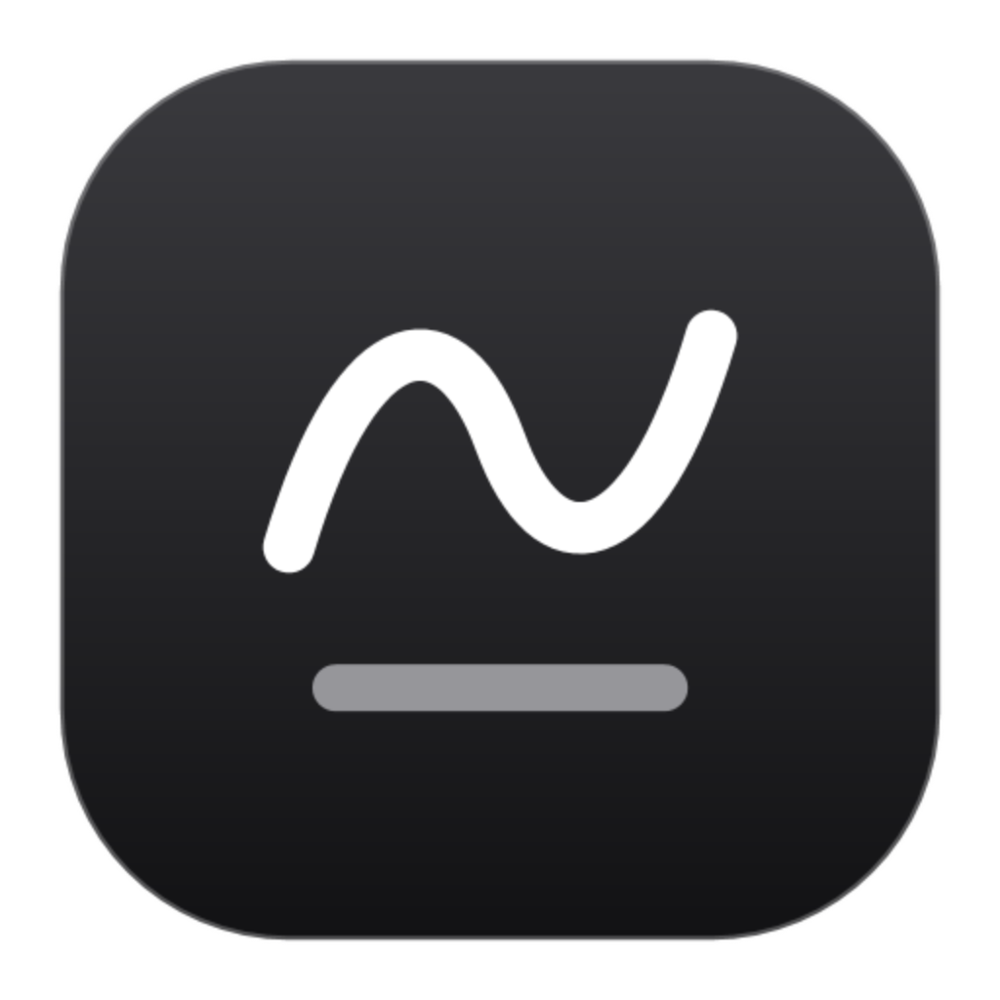
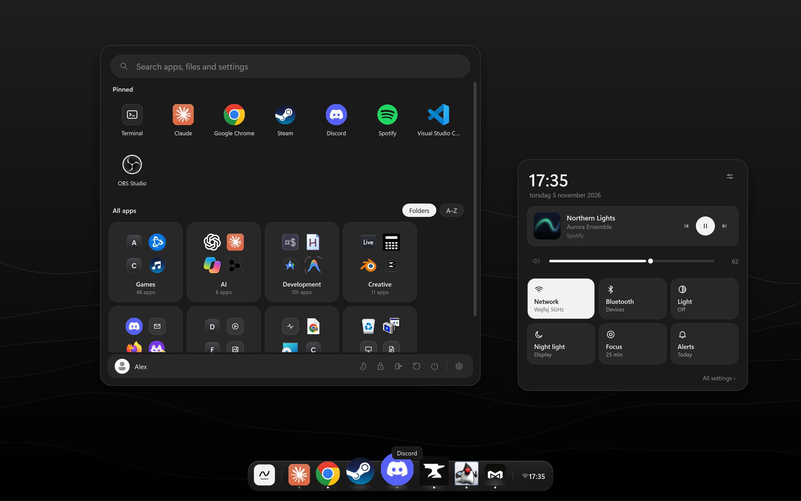
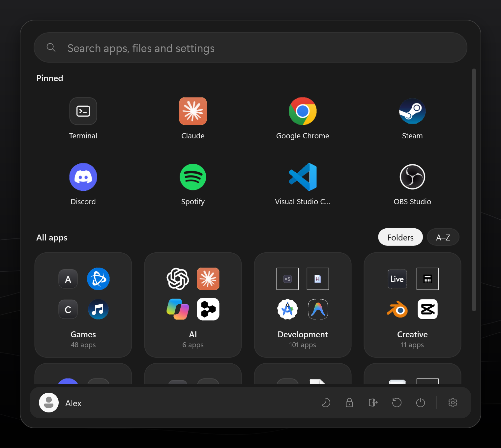
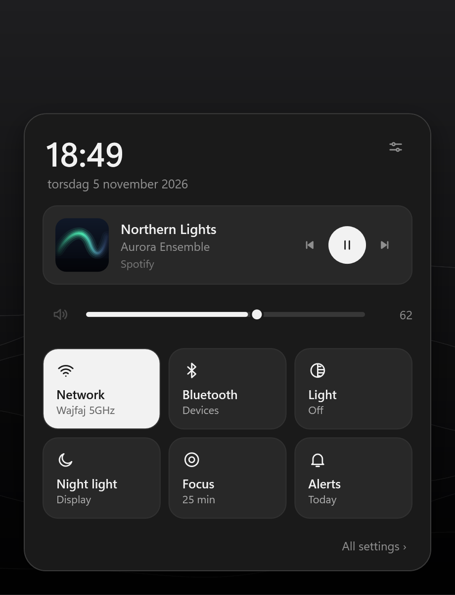
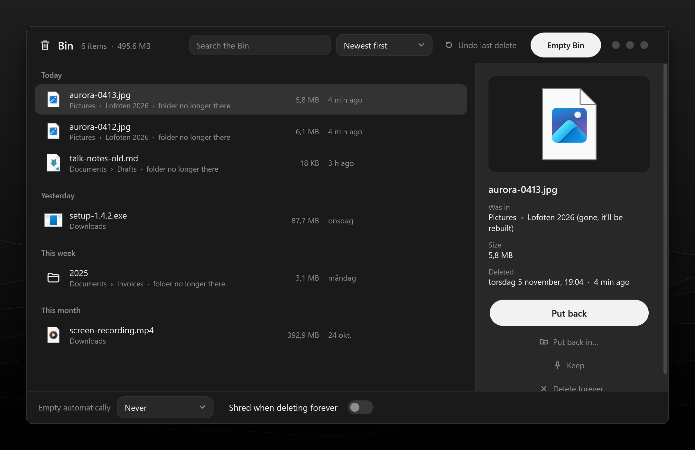
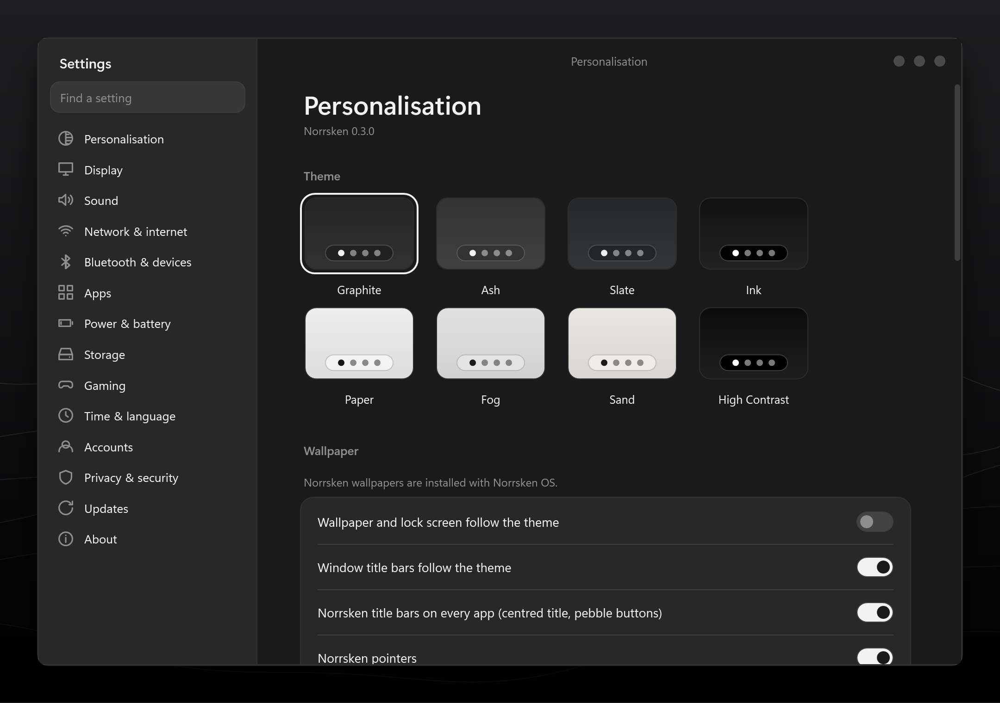
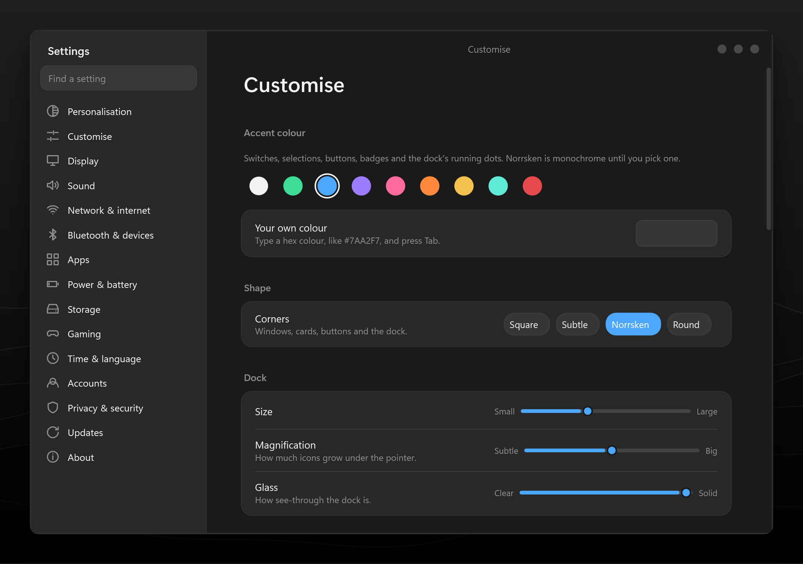
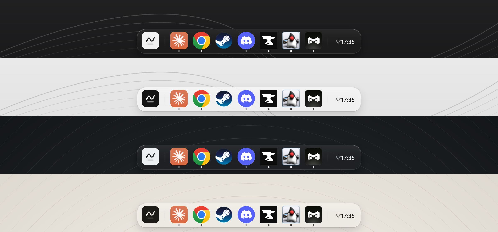

<div align="center">



# Norrsken

**My own desktop for Windows 11.** A dock, a launcher and a whole set of apps that replace the bits of Windows I didn't like looking at.<br>
*Norrsken* is Swedish for the northern lights.

[](https://github.com/gomorron-dev/norrsken/actions/workflows/build.yml)
[](https://github.com/gomorron-dev/norrsken/releases/latest)
[](https://github.com/gomorron-dev/norrsken/releases)


[Install](#install) · [What it replaces](#what-it-replaces) · [Updates](#updates) · [Building it](#building-it) · [Releases](https://github.com/gomorron-dev/norrsken/releases)

<br>

<picture>
  <source media="(prefers-color-scheme: light)" srcset="docs/images/hero-light.png">
  
</picture>

</div>

<br>

I like how Windows runs everything, but I've never liked how it looks or how much of it is trying to
sell me something. So Norrsken swaps out the parts you actually see: the taskbar, Start, Alt+Tab,
the notification centre, File Explorer, Settings, Task Manager, the terminal, Notepad and the
Snipping Tool. Windows is still there underneath, which means every game, launcher and anti-cheat
works exactly like before.

The look is mostly greys, so the only real colour on screen comes from your apps' icons. Everything
moves: icons magnify and bounce, windows spring open, and it all runs at your monitor's full refresh
rate. There are no ads, no "suggestions" and no web results in search. Installed copies update
themselves from the releases here.

## The dock


Hover over it and the icons grow while their neighbours make room. Opening an app makes it bounce,
running apps get a little dot (the one you're using gets a wider bar), and whatever's playing shows
up with its cover art and controls. It gets out of the way for full-screen games, and the Windows
key always brings it back.

## Launcher and Quick Settings

<table>
<tr>
<td width="62%"></td>
<td width="38%"></td>
</tr>
<tr>
<td>The apps you use most at the top, everything else in folders or A–Z, and one search box for apps, files and settings. Typing <code>vsc</code> finds Visual Studio Code, and it learns what you open.</td>
<td>Volume, brightness, Wi-Fi, Bluetooth, night light, a focus timer and what's playing. Click the clock to open it.</td>
</tr>
</table>

## The Bin



I rebuilt the Recycle Bin too. It sits at the end of the dock: drag files onto it to delete them, or
click it to see what you've thrown away, sorted by day.

- Ctrl+Z brings back the last thing you deleted, even if it was fifty files at once.
- Putting something back recreates the folder it came from if that folder is gone. You can also put it somewhere else.
- Pin things you want to keep around, and the automatic clean-up will leave them alone.
- Let it empty itself after 7, 30 or 90 days (or never).
- Shred instead of delete: the file gets overwritten before it's removed.
- It tells you how much space you've freed this month.

Underneath it's still Windows' own Recycle Bin, so Explorer and other apps see the same thing.

## Settings



Display, sound, network, Bluetooth, apps, storage, accounts, privacy and updates are all handled
right there. Nothing kicks you back out to the Windows Settings app.

## Make it yours



Under *Settings › Customise* you can change the feel of the whole thing, and it updates live:

- An accent colour for switches, buttons, selections and the dock's dots. Pick one of eight or type any hex code. Or leave it off and keep everything grey.
- Corner style, from square to very round. It applies to every window, card, button and the dock.
- Dock size, how much the icons grow, and how see-through the dock is.
- How things move (natural, springy, smooth or snappy) and how fast.
- Interface sounds. They're off until you turn them on, each one can be muted or previewed, and you can point it at your own folder of sounds.

*Reduce motion* is still there if you'd rather nothing moved at all.

## Themes



Eight of them: Graphite, Ash, Slate, Ink, Paper, Fog, Sand and High Contrast. The wallpaper, lock
screen and Windows' own light or dark mode switch along with the theme.

## What it replaces

| Windows | Norrsken | Keys |
|---|---|---|
| Taskbar | The dock | Win+T, Win+1…9 |
| Start | Launcher | Win, Win+S |
| Alt+Tab / Task View | Switcher and window overview | Alt+Tab, Win+Tab |
| Action centre | Quick Settings | Win+A |
| Notification centre | Today: notifications, calendar, week | Win+N |
| File Explorer | Files, with tabs, Quick Look and search | Win+E |
| Settings | Norrsken Settings | Win+I |
| Task Manager | Processes, live graphs, startup apps | Ctrl+Shift+Esc |
| Windows Terminal | Norrsken Terminal | |
| Run, Win+X, Project, Clipboard | Norrsken versions of each | Win+R, Win+X, Win+P, Win+V |
| Snipping Tool | Screenshots of an area, a window, the screen or a free-form shape, on any monitor | PrtScn, Win+Shift+S |
| Recycle Bin | The Bin | |
| Photos, Media Player | [Flickerbox](#flickerbox) | |
| Title bars | Centred title with round buttons on the right (apps that draw their own are left alone) | |
| Desktop right-click | Norrsken's menu | |

Shortcuts that move windows around (Win+D, snapping, virtual desktops) are still Windows' own.

## Install

<details open>
<summary><b>On a fresh PC (Norrsken OS)</b></summary>

<br>

Take a Windows 11 install stick, turn it into a Norrsken one, and install from it. From PowerShell
running as administrator:

```powershell
.\os\publish.ps1
.\os\make-usb.ps1 -Drive E: -NoBackup
```

The first time takes about an hour because it builds Norrsken into the Windows image. After that,
running it again only copies what changed and takes a few seconds. There's more in
[os/README.md](os/README.md).

</details>

<details>
<summary><b>On the Windows you already have</b></summary>

<br>

Open the stick and run `Install Norrsken.cmd`. Nothing gets erased. Pick *Reinstall* if you're
replacing an older version.

</details>

<details>
<summary><b>Just the screenshot tool</b></summary>

<br>

```powershell
.\os\payload\Norrsken\Norrsken.Shell.exe --install-capture
```

After that, PrtScn and Win+Shift+S open Norrsken's screenshot tool instead of Windows'. You can
remove it from the Apps list or with `--uninstall-capture`.

</details>

## Updates

Norrsken looks for a [new release](https://github.com/gomorron-dev/norrsken/releases/latest) a couple
of minutes after it starts, then every six hours, and downloads it quietly in the background. When
it's ready, a card asks whether you want to restart Norrsken now to install it. If you say later,
it installs the next time you sign in.

Installing shows a proper update screen while the new files go in (Flickerbox gets updated too), and
when Norrsken comes back it tells you what's new and offers to restart the PC, just to be safe. You
can also check by hand under *Settings › Updates*, or turn the automatic downloads off there.

<details>
<summary>Making a release</summary>

<br>

Bump `<Version>` in `src/Norrsken.Shell/Norrsken.Shell.csproj`, then run:

```powershell
.\os\release.ps1 -NotesFile notes.md
```

That builds everything (with the latest Flickerbox), zips it as `Norrsken-<version>.zip` and puts
it up as release `v<version>`.

</details>

## Flickerbox

Flickerbox is my photo, video and music app. It lives in its own project, and Norrsken ships with
it: it gets installed to `Program Files\Flickerbox`, set as the default for media files, added to
the launcher and kept up to date with Norrsken.

## Building it

You need the .NET 10 SDK on Windows.

```powershell
dotnet build src/Norrsken.Shell -c Release
```

The UI tests click through every window on a hidden desktop, so they never get in the way of what
you're doing. They save screenshots and a `uitest.json` report:

```powershell
src/Norrsken.Shell/bin/Release/net10.0-windows10.0.22621.0/Norrsken.Shell.exe --uitest-isolated uitest-out
```

The pictures in this README come straight out of Norrsken, rendered offscreen with made-up data:

```powershell
src/Norrsken.Shell/bin/Release/net10.0-windows10.0.22621.0/Norrsken.Shell.exe --render-showcase docs/images
```

<details>
<summary>Where things are</summary>

```
src/Norrsken.Shell/
  Interop/      Windows API calls, icons, window identity, the hidden test desktop
  Core/         settings, themes, motion, keyboard hooks, system controls, updater
  Ui/           dock, launcher, quick settings, Today, Files, Settings, Terminal, Task Manager, Bin, title bars
  Showcase.cs   the README and release pictures
  UiTest*.cs    UI tests
os/
  publish.ps1   builds the self-contained app with Flickerbox and the sounds
  make-usb.ps1  turns a Windows 11 install stick into a Norrsken stick
  build-iso.ps1 the same thing as an ISO
  release.ps1   puts a release up on GitHub
  lib/          what gets built into the Windows image
docs/           how it works, and the pictures
```

</details>

## A note on Windows

A Norrsken stick or ISO contains Microsoft's Windows, which is licensed to you. Use it on your own
machines and don't share it. This repo only has Norrsken's own code and art in it.
